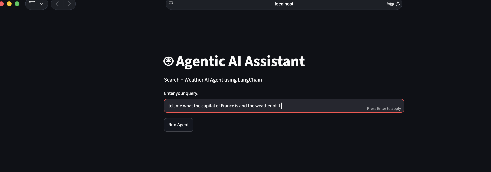
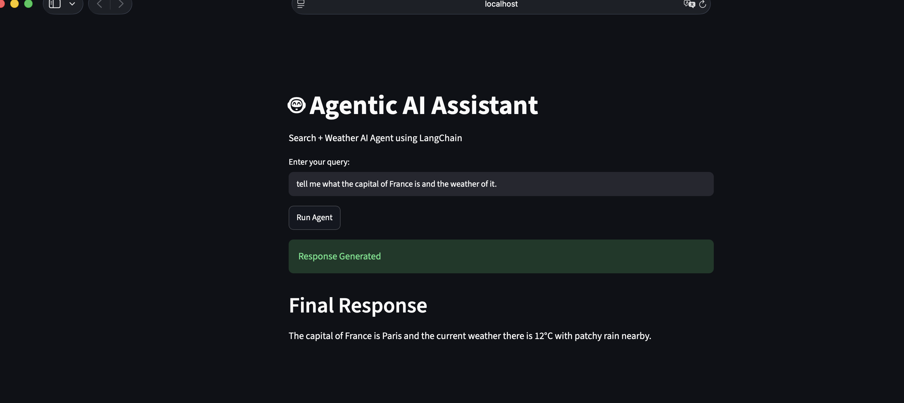

# Langchain-Agent

A practice project for learning to build tool-using LLM agents with LangChain.
It contains a research notebook and a Streamlit app where a ReAct agent answers questions using web search and live weather data.

## Goals

- Learn how LangChain agents decide when to call tools
- Wire up external tools: web search (Tavily) and weather (Weatherstack)
- Pull a shared prompt from the LangSmith Prompt Hub
- Wrap the agent in a simple Streamlit UI

## Limitations

- Practice code, not production: no tests, no rate limiting, minimal error handling
- Uses LangChain's legacy ReAct agent (`langchain-classic`); the notebook also shows the current `create_agent` API
- Requires paid or free-tier API keys for OpenAI, Tavily and Weatherstack

## Project structure

```
.
├── research/
│   ├── agent_demo.ipynb   # Step-by-step experiments: LLM, Tavily search, agents
│   └── app.py             # Streamlit app: ReAct agent with search + weather tools
├── main.py                # Placeholder entry point
├── pyproject.toml         # Dependencies (managed with uv)
└── .env                   # API keys (not committed)
```

## Requirements

- Python 3.14+
- [uv](https://docs.astral.sh/uv/)
- API keys:
  - [OpenAI](https://platform.openai.com/)
  - [Tavily](https://tavily.com/)
  - [Weatherstack](https://weatherstack.com/)
  - Optional: [LangSmith](https://smith.langchain.com/) for tracing and the prompt hub

## Setup

```bash
uv sync
```

Create a `.env` file in the project root:

```
OPENAI_API_KEY=...
TAVILY_API_KEY=...
WEATHERSTACK_API_KEY=...

# Optional: LangSmith tracing
LANGSMITH_TRACING=true
LANGSMITH_API_KEY=...
LANGSMITH_PROJECT=langchain-agent
```

`.env` is listed in `.gitignore`. Never commit it.

## Usage

### Streamlit app

```bash
uv run streamlit run research/app.py
```

Enter a query such as `Find the capital of India and current weather` and click **Run Agent**.
The agent searches the web and calls the weather tool as needed.

| Enter a query | Agent response |
| --- | --- |
|  |  |

### Notebook

Open `research/agent_demo.ipynb` in VS Code or Jupyter and select the project's `.venv` kernel.

## How it works

1. `ChatOpenAI` is the language model.
2. Tools: `TavilySearchResults` for web search and a custom `get_weather_data` tool that calls the Weatherstack API.
3. The `hwchase17/react` prompt is pulled from the LangSmith Prompt Hub with `Client().pull_prompt(...)`.
4. `create_react_agent` and `AgentExecutor` run the reason-and-act loop until the agent has a final answer.

## Troubleshooting

- **`ModuleNotFoundError` when running the app:** you are using a different Python or Streamlit than the project's. Run with `uv run`, or activate `.venv` first.
- **`cannot import name 'hub'`:** `langchain.hub` and `langchainhub.hub` no longer work. Use `langsmith.Client().pull_prompt(...)`.
- **`Pulling a public prompt ... is disabled by default`:** pass `dangerously_pull_public_prompt=True`, and only for prompts from authors you trust.
- **`create_react_agent` import error:** import it from `langchain_classic.agents`, not `langchain.agents`.
